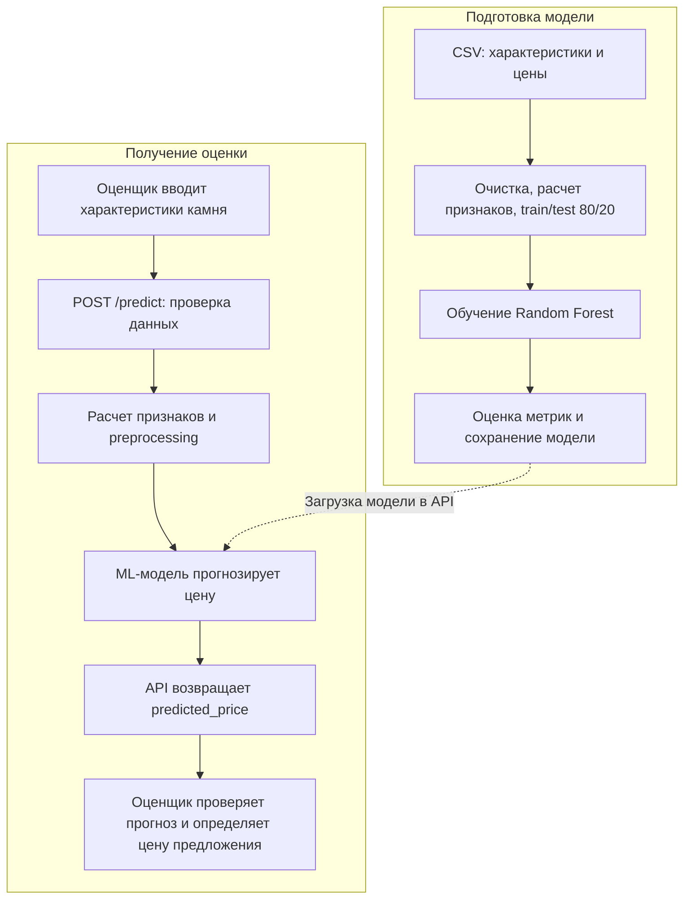

# Модель в процессе оценки бриллианта

В проекте реализованы обучение модели и API прогнозирования. Работа оценщика на схеме — предполагаемый сценарий использования.

## Схема процесса

## Задача модели

Рассчитать предварительную цену бриллианта по его массе, качеству и размерам. Этот расчет помогает оценщику подготовить предложение клиенту.

## Почему используется ML

Цена зависит от сочетания характеристик: например, влияние массы может различаться для камней разной чистоты. Случайный лес позволяет учитывать такие нелинейные зависимости по примерам с известными ценами. Преимущество перед ручными правилами в проекте отдельно не измерялось.

## Входные данные

API принимает девять признаков: `carat` — массу; `cut`, `color`, `clarity` — огранку, цвет и чистоту; `depth`, `table` — пропорции; `x`, `y`, `z` — размеры. Перед прогнозом вычисляются еще три признака: `volume`, `density`, `depth_to_width`.

Для обучения нужна известная цена `price`; CSV размещается в `data/raw/diamonds.csv`. Проект рассчитан на Diamonds Dataset с Kaggle. Текущий локальный запуск использовал демонстрационный набор из 500 строк: 400 для обучения и 100 для проверки.

## Использование результата

API возвращает `predicted_price` с округлением до двух знаков. Оценщик сопоставляет прогноз с сертификатом и актуальными рыночными предложениями, затем определяет итоговую цену. Заключение сделки остается за человеком.

Качество оценивается на отложенных 20% данных. В текущем запуске: **RMSE — 589,59; MAE — 483,14; R² — 0,9631; MAPE — 7,06%**. Эти результаты относятся к локальному демонстрационному набору. Перед применением на рынке нужна проверка на актуальных данных. Подробности: [model_card.md](model_card.md).
