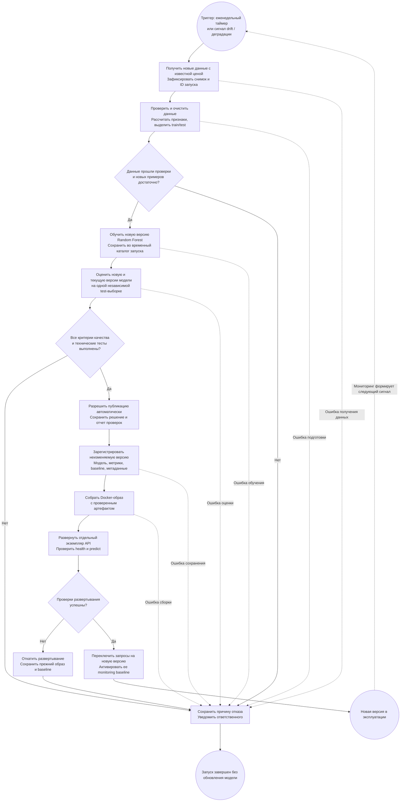

# Автоматическое переобучение модели оценки бриллиантов

Модель `RandomForestRegressor` прогнозирует цену `price` по характеристикам бриллианта. Ниже описан **предлагаемый процесс автоматического переобучения** на основе существующих модулей проекта. Сейчас реализованы ETL, обучение, расчет метрик, сохранение артефактов, функции мониторинга и API. Планировщик, автоматическое принятие решения о публикации, версионирование и деплой предстоит настроить.

## Схема процесса

На диаграмме Mermaid круги обозначают начало и завершение процесса, прямоугольники — действия, ромбы — проверку условий с выбором одной из веток «Да/Нет».

## Этапы и передаваемые результаты

| Этап | Что происходит | Результат для следующего шага |
| --- | --- | --- |
| 1. Триггер | Планировщик запускает процесс раз в неделю. Вне расписания запуск инициируется сигналом `detect_data_drift` или `detect_degradation` из `src/monitoring.py`. Одновременно выполняется один запуск. | ID запуска и причина переобучения. |
| 2. Получение данных | Из источника подтвержденных оценок или сделок поступает новая партия с девятью исходными признаками и известной `price`. Она объединяется с историей; снимок входного CSV фиксируется по версии и хешу. Рабочий вход ETL — `data/raw/diamonds.csv` в изолированном каталоге запуска. | Воспроизводимый набор размеченных данных. |
| 3. Подготовка и проверка | Логика `src/data_processing.py` проверяет колонки и числовые типы, удаляет дубликаты, пропуски и некорректные значения; добавляет `volume`, `density`, `depth_to_width`. Формируется разбиение 80/20 с `random_state=42`. Test не должен содержать строки из обучения текущей модели: для него отбираются новые размеченные примеры. | Зафиксированные `train.csv`, `test.csv` и отчет о качестве данных. При отсутствии достаточных новых данных запуск завершается без обновления. |
| 4. Обучение | `build_model` и `train_model` из `src/model_training.py` обучают preprocessing и Random Forest только на train. Пути сохранения модели, метрик и baseline направляются в каталог новой версии, отдельно от эксплуатационных файлов. | Новая версия модели: sklearn Pipeline с preprocessing и моделью, параметры обучения и журнал запуска. |
| 5. Проверка качества | Новая и текущая версии модели оцениваются на одном test по RMSE, MAE, R² и MAPE. Проверяется загрузка артефакта и выполняются существующие тесты данных, модели, API и мониторинга. | Сравнительный отчет метрик и результаты технических тестов. |
| 6. Решение о публикации | Отдельный шаг Python-скрипта автоматизации получает отчет предыдущего этапа и проверяет: RMSE новой версии ниже минимум на 2%, MAE и MAPE не выросли, R² не снизился, проверки данных и технические тесты прошли. Если все условия выполнены, скрипт разрешает сохранение версии и переход к деплою. Если хотя бы одно условие нарушено или результат проверки отсутствует, скрипт останавливает публикацию и записывает причину отказа. Проверки уже развернутого API выполняются отдельно на этапе 8. | Решение «разрешить» или «отклонить» и отчет с результатом каждой проверки. |
| 7. Сохранение версии | Одобренная новая версия модели сохраняется, например, в `models/versions/<run_id>/`: `diamond_price_model.joblib`, `metrics.json`, `baseline.json`, метаданные с хешем данных, версией кода, параметрами и отчетом приемки. | Неизменяемый комплект версии, пригодный для развертывания и отката. |
| 8. Деплой | В Docker-образ включается именно проверенная модель вместе с ее метриками. Образ получает тег версии; повторное обучение при сборке исключается. Отдельный экземпляр FastAPI проходит проверки, после чего на него переключаются запросы. API загружает модель при запуске, поэтому для новой версии запускается новый процесс. | Работающая версия API, ID активной модели и соответствующий baseline мониторинга. |
| 9. Обработка отказов | Ошибка данных, обучения, тестов, сохранения или сборки завершает запуск с отчетом и уведомлением ответственного. При неудачном развертывании восстанавливается прежний экземпляр API. После исправления причины возможен новый запуск. | Текущая рабочая модель продолжает обслуживать запросы; причина отказа сохранена. |

## Условия запуска и допуска в эксплуатацию

**Сигналы мониторинга.** В существующих функциях заданы пороги по умолчанию: drift — изменение среднего хотя бы одного числового признака более чем на 25% относительно baseline; деградация — рост RMSE более чем на 15% или снижение R² более чем на 0,10. Для оценки деградации нужны фактические цены по новым прогнозам. Сам сигнал запускает проверку возможности переобучения, но не разрешает публикацию.

**Предлагаемые условия приемки** задаются до запуска и сохраняются в его конфигурации; отдельный шаг скрипта для принятия решения о публикации пока не реализован. Первые три условия проверяются до сохранения версии, последнее — при развертывании перед переключением запросов:

- Доступны реальные новые данные с `price`; демонстрационный набор, автоматически создаваемый при отсутствии CSV, к публикации не допускается. После очистки есть минимум 400 обучающих и 100 независимых тестовых записей. Пересечение test с обучающими данными обеих моделей исключено; при невозможности подтвердить это публикация блокируется.
- Все метрики конечны. На общей test-выборке `RMSE_new <= 0.98 * RMSE_current`, `MAE_new <= MAE_current`, `MAPE_new <= MAPE_current` и `R²_new >= R²_current`, где `new` — новая версия, `current` — текущая версия в эксплуатации. Таким образом, требуется улучшение RMSE минимум на 2% без ухудшения остальных метрик. Если текущую модель нельзя загрузить или ее RMSE равен нулю, автоматическая публикация блокируется и требуется разбор ответственным.
- Технические тесты прошли, сохраненный Pipeline загружается и формирует конечные положительные прогнозы на контрольных примерах.
- Версия полностью сохранена, Docker-образ собран, проверка `GET /health` возвращает HTTP 200 и `model_loaded=true`, а контрольный `POST /predict` возвращает HTTP 200 и корректный `predicted_price`. Одного ответа `/health` недостаточно для допуска.

Только после выполнения всех условий запросы переключаются на новую версию и ее baseline становится активным. Предыдущая версия и ее baseline сохраняются для отката. Мониторинг продолжает проверять данные и качество, формируя сигналы для следующих запусков.

Связанные материалы: [место модели в бизнес-процессе](Model_BPMN.md), [карточка модели](model_card.md), [текущий pipeline](run_pipeline.py). Текущий CI выполняет линтеры, тесты и сборку Docker; автоматический процесс, показанный выше, является проектной схемой его расширения.
